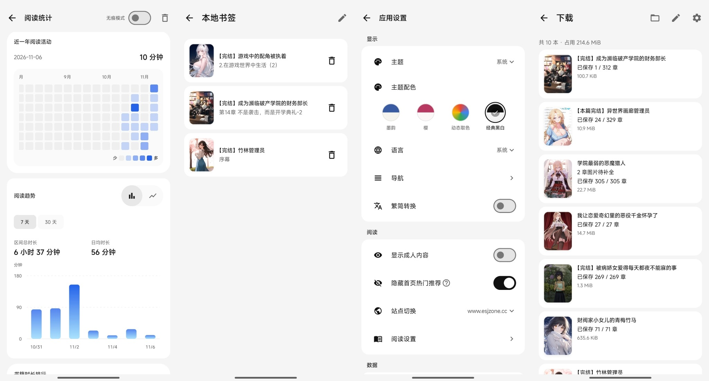

  

<h1 align="center">EsjzoneViewer</h1>

面向 Android 的 ESJ Zone 第三方小说阅读客户端

  
  
  

  <a href="#preview">界面预览</a> ·
  <a href="#features">功能特性</a> ·
  <a href="#download">下载与使用</a> ·
  <a href="#usage-notes">使用与数据说明</a> ·
  <a href="https://github.com/breakyuna/EsjzoneViewer/issues">反馈问题</a> ·
  <a href="#acknowledgements">致谢</a>

> **声明**：EsjzoneViewer 是 ESJ Zone 的第三方 Android 应用，并非 ESJ Zone 官方客户端。本项目基于 [DeeChael/Esjzone](https://github.com/DeeChael/Esjzone) 继续开发，遵循 [GPL-3.0](LICENSE) 开源协议；详见文末 [项目来源与权利声明](#origin-and-rights)。

---

## 📷 界面预览

  

  

---

## ✨ 功能特性

### 📖 阅读体验与深度定制

- **双布局与流畅翻页**：支持上下滚动与左右分页（平移、淡入淡出、覆盖翻页），提供侧边点击翻页、音量键翻页，以及滚动侧滑目录/评论、分页下拉书签等手势交互。
- **目录与进度定位**：目录支持按分卷折叠及正序/倒序切换，支持全书进度定位、加密章节密码解锁与自动续读。
- **书签与正文划线**：支持段落级多书签（记录原文锚点与摘录）及可选的“长按划线”功能（支持跨段划线、放大镜预览与点击取消）。
- **精细排版与文本处理**：支持字号、行距、边距、按小说独立保存首行缩进（0 / 1 / 2 字）、简繁转换、人名替换规则（支持单本/全局与正则），以及按需下载开源阅读字体（思源宋体、思源黑体、霞鹜文楷）。
- **视觉增强与工具栏**：支持亮度、护眼模式、保持亮屏、系统栏与状态信息自定义、快捷工具栏配置；支持自定义图片背景（可调模糊度、透明度、文字颜色与文字辉光）。

### 📚 本地优先书架、离线与备份

- **本地优先书架**：结合云端收藏补充，支持宫格/列表切换、自定义分组、排序、批量管理，以及按书名、作者或本机已缓存标签的本地搜索（简繁不敏感）。
- **历史与阅读统计**：本地阅读历史与云端历史分开展示；内置阅读统计（阅读时长、趋势、书籍排行、标签分布），支持暂停计时的无痕模式。
- **离线下载与导出**：支持后台下载、补下载与离线直读，支持按已下载章节导出 TXT 或 EPUB；下载目录可迁移至公共存储并支持重新扫描。
- **本地备份与自动备份**：支持按类别手动导入/导出 ZIP 备份，并支持可调周期的后台自动备份与可选下载内容备份。

### 🔍 内容发现、社区与会员

- **浏览与搜索**：提供热门推荐、最新更新、随机推荐（支持隐藏首页推荐）、分类浏览、关键词与作者搜索、多维筛选及搜索历史。
- **社区互动**：支持浏览与参与论坛、留言板、灌水楼、小说及章节评论与回复。
- **会员中心**：只读查看注册日期、升级进度、系统消息、我的回复与经验记录；回复条目仅提供跳转小说详情或复制链接，不带登录态打开章节页，以免改写网站观看记录。
- **多站点与站外链接**：支持切换 `www.esjzone.cc` 与 `www.esjzone.one`，支持 ESJ 目录中的部分文库8章节阅读与下载；遇到站点验证时可在应用内完成，其他站外链接交由浏览器打开。

### ⚙️ 界面外观与多端适配

- **主题与个性化**：支持浅色/深色/跟随系统主题、多种预设配色与 Android 12+ 动态取色；支持底部导航顺序与启动页自定义、中英文界面切换与全局简繁转换。
- **平板横屏适配**：在宽屏横屏环境下提供侧边导航与双栏布局（首页多列、小说详情双栏、设置双栏、统计并排展示等）。
- **维护与更新**：内置存储空间统计、缓存清理、日志查看与应用内更新检查。

---

## 📥 下载与使用

**下载渠道：[GitHub Releases](https://github.com/breakyuna/EsjzoneViewer/releases)**

1. 在 **Android 10（API 29）及以上**设备中下载 Release 中的 APK 并安装。
2. 在登录页或设置页选择可用站点：`www.esjzone.cc` 或 `www.esjzone.one`。
3. 使用 ESJ Zone 账户登录后，即可浏览小说、管理本地书架或继续阅读。

> 💡 已下载章节可直接在应用内离线阅读，无需先导出 TXT 或 EPUB；未下载正文、远程插图与在线社区功能仍需网络连接。

---

## 📋 使用与数据说明

### 🌐 数据来源与网络请求

- 小说、封面、章节、评论等内容主要来自当前选择的 ESJ Zone 站点；目录中的部分文库8章节链接会访问文库8获取正文。应用仅提供面向 Android 设备的浏览与阅读界面，不代表原站发布内容或作出承诺。
- 检查/下载应用更新，以及按需下载内置开源阅读字体（附 SHA-256 校验），会访问 GitHub 及其附件下载服务，**均不携带 ESJ Zone 登录会话**。

### 🔐 账户、会话与网站记录

- **双站点登录**：登录时，应用会尝试向 `www.esjzone.cc` 和 `www.esjzone.one` 分别发送账号与密码以建立各站点会话；会话仅保存在本机。切换站点时若目标站点会话不可用，使用会员功能可能需要以同一账号补登。
- **本地数据与网站观看记录**：应用设置、搜索历史、书架、本地阅读历史、书签、划线与阅读统计均保存在本机；本地阅读历史不会上传，与云端历史分开展示。由于站点正文必须携带登录 Cookie 才能读取，已登录时网站观看记录总会停留在最后请求的章节（无关闭开关）；阅读已下载或仅来自缓存的章节时，应用也会补请求该章节页面。
- **后台下载时的记录保护**：后台下载或批量解锁结束后，若下载前网站已有该书观看记录则会尝试恢复原记录；若原本没有记录，则会重新请求第一章，使站点记录停留在第一章。
- **书架与云端收藏**：云端收藏仅用于补充本地书架，不会因云端缺失而删除本地书籍；主动从书架移除书籍时，应用会尝试取消对应的云端收藏。

### 💾 存储与备份边界

- **存储位置**：下载与自动备份支持授权公共存储目录并迁移，支持重新扫描恢复下载索引；未选择公共目录时保存在应用私有目录，卸载或清除应用数据前请按需导出。应用会缓存网页与图片并保存下载章节，请妥善保护设备与应用数据。
- **备份范围**：自动备份默认关闭；手动与自动备份默认不包含下载内容，可按需开启。备份支持按类别选择**本地书架、书架分组、阅读设置（含自定义背景照片与按小说缩进）、书签、阅读划线、本地阅读历史、阅读统计、搜索历史与下载内容**；**不包含**网站收藏、在线阅读历史、登录会话/凭据、已保存的章节密码、阅读设置以外的应用设置与临时缓存。详见 [本地数据备份与书架分组](LOCAL_BACKUP.md)。

### ©️ 内容与使用边界

- 小说、插画、封面及其他站点内容的相关权利归各自权利人所有，本项目不声称拥有这些内容。
- 使用、下载或导出内容时，请遵守原站规则与适用要求，尊重作者与译者权益。
- 成人内容显示可在设置中开关，请根据年龄及所在地要求合理使用。
- 站点结构、登录状态或网络环境变化可能影响在线功能，应用不保证所有页面始终可用。

---

## 📜 项目来源与权利声明

本项目基于 [DeeChael/Esjzone](https://github.com/DeeChael/Esjzone) 继续开发，在原有基础上持续改进阅读体验、本地书架、离线下载与社区功能，感谢原作者的贡献。

- **原始项目**：[DeeChael/Esjzone](https://github.com/DeeChael/Esjzone)
- **原作者**：[DeeChael](https://github.com/DeeChael)
- **当前维护者**：[breakyuna](https://github.com/breakyuna)
- **开源许可证**：[GNU General Public License v3.0](LICENSE)

若 ESJ Zone（`www.esjzone.cc` / `www.esjzone.one`）运营方或相关权利人认为本应用存在不当行为，请通过 [GitHub Issues](https://github.com/breakyuna/EsjzoneViewer/issues) 联系维护者，说明相关页面与具体问题，以便核实处理。

---

## 🛠️ 技术栈

- **Kotlin / Coroutines**：开发语言与异步并发
- **Jetpack Compose / Material 3 / Material 3 Adaptive**：声明式界面、动态取色与宽屏自适应布局
- **AndroidX Navigation 3 + Kotlinx Serialization**：类型安全的页面与 Tab 导航
- **Room**：本地书架、分组、阅读历史、书签、划线与阅读统计存储
- **DataStore**：应用与阅读设置持久化
- **WorkManager**：后台下载、字体按需下载与定时自动备份
- **OkHttp & Jsoup**：网络请求、会话管理与 HTML/CSS 解析
- **Coil & Telephoto**：封面、头像、插图加载与可缩放图片查看
- **Gson & RE2/J**：本地备份序列化与线性时间正则人名替换
- **Baseline Profile**：启动与列表滚动性能优化

## 🌐 网络接口与页面分析

ESJ Zone 的网络请求、登录认证、页面结构与 HTML 解析说明整理在 [`NETWORK/`](NETWORK/) 目录中。

这些文档基于页面结构分析、维护者抓包确认与客户端实际实现持续维护，同时涵盖解析约束与本地存储边界。它们并非 ESJ Zone 官方 API 文档；推断或尚未验证的内容均已标注，参考时请注意验证状态。

## 🐛 反馈与贡献

欢迎通过 [Issues](https://github.com/breakyuna/EsjzoneViewer/issues) 反馈问题或提出建议，也欢迎提交 Pull Request。提交问题时请尽量提供：

- 应用版本、设备型号与 Android 版本
- 复现步骤、预期表现与实际表现
- 相关页面地址、截图或脱敏后的错误日志

> 🔒 提交截图与日志前，请务必移除密码、Cookie、会话凭据及其他敏感个人信息。涉及账户或凭据的安全问题请遵循 [安全说明](SECURITY.md)，切勿公开披露敏感细节。

开发前请先阅读 [项目协作指南](AGENTS.md)，遵循其中的修改边界与验证要求。更多说明文档：

- [本地数据备份与书架分组](LOCAL_BACKUP.md)
- [阅读器手势与排版说明](docs/reader-gestures.md)
- [平板横屏布局说明](docs/wide-layout.md)

## 🙏 致谢

感谢原作者 [DeeChael](https://github.com/DeeChael) 奠定项目基础，感谢所有参与开发、测试与反馈的贡献者。

同时感谢 Jetpack Compose、Material 3、Room、AndroidX Navigation 3、[OkHttp](https://github.com/square/okhttp)、[Coil](https://github.com/coil-kt/coil)、[Gson](https://github.com/google/gson)、[Jsoup](https://github.com/jhy/jsoup)、[RE2/J](https://github.com/google/re2j) 与 [Telephoto](https://github.com/saket/telephoto) 等开源项目，以及思源宋体、思源黑体与霞鹜文楷的字体作者。

## 📄 许可证

本项目采用 **GNU General Public License v3.0**，完整文本见 [LICENSE](LICENSE)。项目保留原始版权与许可证信息，第三方依赖与阅读字体各自遵循其开源协议。

应用内可在 **设置 → 关于 → 开源许可** 中离线查看本项目、第三方依赖与阅读字体的来源及完整许可文本。依赖许可存放于 `app/src/main/assets/open_source_licenses/`，字体许可存放于 `app/src/main/assets/font_licenses/`；新增依赖时请同步补充对应归属与许可。
